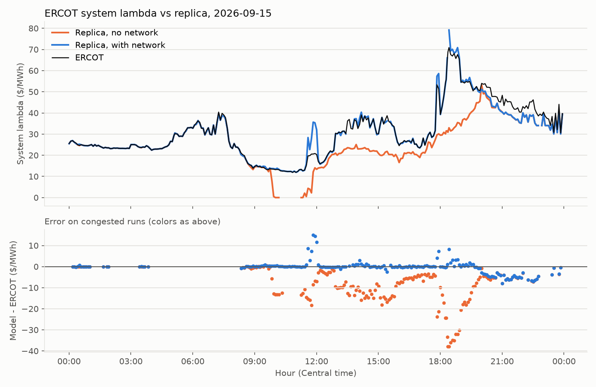

# ercot-sced-replica

[](https://github.com/fig-tensor/ercot-sced-replica/actions/workflows/ci.yml) [](https://github.com/fig-tensor/ercot-sced-replica/releases) [](LICENSE)

ERCOT's real-time market is cleared every five minutes by Security-Constrained Economic Dispatch (SCED), an optimization that chooses each resource's output and sets the price of electricity at every node in Texas. The prices are public, but the model that produces them is not. In this project we replicate SCED from ERCOT's public data alone, re-solve every run of a day, and test the result against ERCOT's published prices. Since December 2025 (Real-Time Co-optimization plus Batteries, RTC+B), SCED also clears five ancillary services alongside energy, and the replica does the same.

Our findings show that a model built entirely from public data reproduces ERCOT's clearing closely. Over 61 days (July 27 to September 25, 2026; 17,727 SCED runs), with transmission constraints estimated from public prices, dispatchable batteries and co-optimized ancillary services, the replica's system price (λ) is within $1 of ERCOT's on 97.8% of runs where no transmission constraint binds and on 85.1% of congested runs. Moreover, ERCOT's own awards turn out to be informative: by scoring candidate rules against them, we recovered clearing rules that the Protocols do not state in a form an optimizer can use directly (see Methodology: Ancillary services).

## Results at a glance

| Measure (61 days, full model) | Result |
|---|---|
| System price, no binding constraint | Within $1 of ERCOT on 97.8% of runs; median absolute error $0.01/MWh |
| System price, congested runs | Within $1 on 85.1% of runs; median absolute error $0.15/MWh |
| Effect of adding ancillary services | Congested-run error lower on 60 of 61 days (monthly medians $0.23-0.32 down to $0.14-0.18) |
| Ancillary-service prices (five services) | Median error under half a cent; at most 4 cents at the 90th percentile (12 cents for Regulation Down) |
| Day-ahead forecast of binding constraints | AUC 0.88; 19% lower Brier score than the recent binding rate |

The price figures are reproducible from the per-run results committed in `results/`; the forecast figures come from the walk-forward test described under Day-ahead congestion forecast. The estimated network (shift factors and the resource-to-node map) is published with the v0.8.0 release.



## Status

**Complete (November 2026); no longer in active development.** A scheduled daily run keeps validating the newest disclosed day until about March 1, 2027; its record is in `results/daily.csv`. Bug reports are read; new features are not planned.

## Background and motivation

ERCOT publishes the inputs to SCED (every resource's offer curve, limits and dispatch) with a 60-day delay, and its outputs (system lambda, nodal prices and constraint shadow prices) within a day. What it does not publish is the network model: the shift factors that map each resource's output onto each transmission line are posted only to its secure Market Information System, which requires market-participant credentials. As a result, an open replica has to answer two questions at once: whether the clearing rules can be reproduced from the disclosed inputs, and whether the network can be recovered from public prices well enough to price congestion.

The approach here is incremental. We begin with an energy-only model on a single node (a "copper plate"), then add the estimated network, then dispatchable batteries, and finally co-optimized ancillary services, measuring at each step how much closer the replica comes to ERCOT. Put simply, each component has to earn its place in the validation numbers.

## Quick start

Clone the repository and install [uv](https://docs.astral.sh/uv/):

```bash
git clone https://github.com/fig-tensor/ercot-sced-replica.git
cd ercot-sced-replica
```

Run the tests:

```bash
uv sync
uv run pytest
```

Re-clear one day (needs ERCOT Public API credentials in `.env`: `ERCOT_API_USERNAME`, `ERCOT_API_PASSWORD`, `ERCOT_PUBLIC_API_SUBSCRIPTION_KEY`):

```bash
uv run --env-file .env scedrep YYYY-MM-DD
```

Add `--as` to also clear it with ancillary services co-optimized (results in `results/runs_as/`), and give a second date to run a range. Only what is missing is solved: a model whose per-run file for that day exists is not run again (older days predate `runs_net/` and `runs_both/`, so a range fills those in):

```bash
uv run --env-file .env scedrep YYYY-MM-DD --as
uv run --env-file .env scedrep 2026-07-27 2026-09-25 --as
```

Summarise the ancillary-service results already saved in `results/` (no downloads): reserve-price errors by service, and λ errors by month against the energy-only model:

```bash
uv run python scripts/as_report.py 2026-07-27 2026-09-25
```

Build the forecasting dataset and run the walk-forward test (save as a script and run it with `uv run --env-file .env python <script>`; downloads are cached in `data/`):

```python
from gridstatus.ercot_api.ercot_api import ErcotAPI

from scedrep.forecast import dataset, score, walk_forward

X, Y = dataset(ErcotAPI(), "2026-06-01", "2026-11-20")
R = walk_forward(X, Y, "2026-08-01", "2026-11-20")
print(score(R))
```

## Methodology

### Clearing model

- Offer curves - SCED2 (mitigated) curves, linear between points, so cost is quadratic and the problem is a convex QP. Checked against ERCOT: hand-interpolating the marginal unit matched published λ to the cent.
- Dispatchable set - online units only (status ON*) with HDL - LDL > 0.1 MW. Offline units (OFF, OUT, EMR) still carry live HDL/LDL in the data; leaving them in cost $13.90 on the first interval.
- Load and fixed injections (fixed gens) - taken at SCED base points. Batteries are dispatched by the model (see Methodology: Batteries).
- Validation target - UncappedSystemLambda. Where ERCOT's uncapped value is missing (older days), CappedSystemLambda is used instead; if the live endpoint has no data, the archive's SystemLambda (no capped/uncapped split). The two matched on every 2026-09-08 run.
- Numerical cleaning - segments under 0.1 MW dropped, slopes outside [0.001, 1000] flattened at average price.
- Solver - PIQP (interior point), with the model written as sparse matrices. If a run fails, it is retried with stricter PIQP settings, then with HiGHS (active set; tolerances primal 1e-4 MW, dual 1e-6 $/MWh, 20 s limit); each run records which solver produced it (see Methodology: Solver).

### Transmission network

When a transmission line is full, cheap power cannot reach load, so ERCOT dispatches more expensive units and prices rise. A model without the network misses this and comes out too low on congested runs, which is why the network is the first component we add.

ERCOT posts shift factors (how much each unit's output loads each line) only to the MIS Secure Area, which requires market-participant credentials, so we estimate them from public data. In each SCED run, a node's price is LMP = λ - Σ SF·μ, summed over the binding constraints. Regressing node prices on ERCOT's published shadow prices μ over the previous 14 days recovers the shift factors. The replica then adds one constraint per binding line, anchored at ERCOT's flow, with ERCOT's shadow-price cap as the penalty for overloading it.

### Batteries

Batteries are now a large share of evening supply in ERCOT, and they also set prices overnight when they charge. Since RTC+B, ERCOT publishes each battery as one offer curve covering both directions: charging (negative MW, down to LDL) and discharging (positive MW, up to HDL). We clear batteries on those curves like any other resource, so their output responds to price instead of being fixed at ERCOT's answer.

State of charge needed one fix. The published LDL/HDL ignore how full a battery is: on 2026-09-21 at 04:45, four full batteries still showed full charging ability, and the model charged them about 280 MW while ERCOT charged them about 0. The replica caps each battery by its stored energy over one 5-minute interval:

- charging limit: max(LDL, -(Max SOC - SOC) × 12)
- discharging limit: min(HDL, (SOC - Min SOC) × 12)

Checked against every battery in every run that day (87,360 battery-runs), ERCOT's base points fall outside these limits in 0.6% (charging) and 0.02% (discharging) of cases, mostly sub-1 MW trickle charging on full batteries.

### Ancillary services

Since RTC+B (December 2025), ERCOT's real-time market clears energy and five ancillary services together: Regulation Up and Down, Responsive Reserve (RRS), Contingency Reserve (ECRS) and Non-Spinning Reserve. Each service has a price (MCPC) set by its own supply and demand, and holding capacity in reserve competes with producing energy, so reserve prices feed into λ. An energy-only model cannot produce that.

We co-optimize them from ERCOT's public data:
- Offers - each resource offers up to six blocks; a block has one MW quantity shared by every service it prices (verified on 2026-09-21: ERCOT's awards fit this reading on every unit-run). RRS sub-types keep their own prices: primary frequency response (PFR) and fast frequency response (FFR); under-frequency relay (UFR) comes from Load Resources. ERCOT's proxy offers for resources that did not offer are already in the published data.
- Demand - ERCOT's hourly demand curve for each service, linear between points. ERCOT buys the full planned quantity of RegUp, RegDn, RRS and ECRS, with the price set by supply; Non-Spin clears on the sloped part of its curve.
- Fixed - resources the replica does not dispatch (Load Resources, offline units) keep ERCOT's awards.

**Rules recovered from ERCOT's own awards.** ERCOT's base points and awards must satisfy every rule ERCOT enforces, so we scored each candidate rule against them over 2026-09-15 to 09-21 (2.4 million unit-runs): a real rule is never broken and binds sometimes.
- Capacity - output plus up-reserves within the larger of the high sustained limit (HSL) and the high dispatch limit (HDL). ERCOT's solution never exceeds it; HSL alone was exceeded 19 times, all by under 1 MW, on units whose HDL sat just above HSL.
- Award caps - each award within the unit's telemetered capability for that service times its deployment time: 5 minutes for regulation, 10 for ECRS, 30 for Non-Spin. Never broken by any of ERCOT's ~650,000 awards, and binding tens of thousands of times. The same rule with the disclosed ramp rate in place of the capability was broken about 4,600 times.
- RRS from PFR - at least 1,377 MW system-wide, at most 157 MW per resource (ERCOT's 2026 AS methodology). Both bind: ERCOT's total PFR sits at exactly 1,377 MW in nearly every run, and its largest single PFR award is exactly 157.0 MW every day. The minimum is imposed as a cap on FFR (FFR at most the room left after the required PFR), which is the same thing when the RRS curve is bought in full and keeps the solver well-conditioned (see Methodology: Solver).
- Batteries hold enough stored energy to sustain each award (ERCOT's qualification durations: 0.5 h for regulation and RRS, 1 h for ECRS, 4 h for Non-Spin), and regulation awards respect a 5/7 ramp factor from ERCOT's training material.

**Prices.** ERCOT's awards obey the PFR minimum, but its RRS price does not reflect it: on 2026-09-15 and 09-18, RRS prices from a solve without the PFR rows matched ERCOT's (median error $0.004, no run off by more than $1), while the same solve with them was off by more than $1 in over 200 runs. So quantities come from the full model and prices from a second solve without the PFR rows. Why ERCOT's price behaves this way is not established.

### Solver

With ancillary services, a run has about 17,000 variables (thousands of 1-MW demand-curve segments). HiGHS's QP method (active set, which changes one constraint per iteration) slowed from 0.2 s at 200 segments to 8 s at 6,600 on a synthetic test, and on real runs stopped at its time limit or with a false "non-convex" status on problems that are convex and feasible. An interior-point method takes Newton steps on the whole system at once, so its iteration count barely depends on size. Of the open-source QP solvers tested (PIQP, Clarabel, OSQP, SCS, QPALM, ProxQP, HiGHS), PIQP and Clarabel matched HiGHS's answers exactly with default settings; PIQP was fastest and is the default.

Regression, energy only, 2026-09-15 to 09-21: on the 2,019 runs both solvers solved, they never differed by more than $0.01 on the same model. PIQP solved 13 runs HiGHS could not (2,032 against 2,019), every validated median was equal or better, and runs took about 0.02 s instead of 1-2 s.

Telemetry is not always consistent: a unit's sustained limit can sit below its dispatch floor (HSL < LDL, e.g. during a derate). Using the larger of HSL and HDL in the capacity limit keeps every such run feasible.

Interior-point methods need room inside the constraints to move. A first version imposed the PFR minimum as a floor with a penalised shortfall ($10,000/MW). On 20 runs PIQP stalled: in some, the floor coincided with the end of the RRS demand curve, or sat 0.01 MW beyond it, which leaves no interior; in others the large penalty coefficient alone was enough. Stating the minimum as a cap on FFR, with FFR offers dropped when there is no room for them, solved them all, with no penalty. The HiGHS fallback fails on most runs that stall PIQP (it hits its time limit), so it rarely rescues one.

## Results

We report the error as model λ minus ERCOT's system lambda, first for the energy-only model and then as each component is added.

### Energy only, no network

Error = model λ - ERCOT system lambda. 2026-08-10 to 2026-09-19 (41 days, 11,919 SCED runs, 98.4% solved):

- Uncongested runs (3,466) - median error -$0.01/MWh; middle 80% of runs within -$0.86 to +$0.06. The replica reproduces SCED when no transmission constraint binds.
- Congested runs (8,265, 70% of all runs) - median -$4.40; middle 80% within -$33.06 to -$0.06. Copper plate misses congestion; the model runs low (without network constraints; see Results: Adding the network).
- Worst uncongested day - 2026-08-27, median -$26.90: a whole-day miss without congestion was reserve scarcity: with ancillary services co-optimized, that day's median uncongested error is $0.04 (see Results: Adding ancillary services).
- 2026-09-08 by hour - essentially exact 0:00-8:00; -$6 to -$11 through the solar hours (10-16); -$30 to -$53 at the evening net peak (18-21), with ERCOT at $459 at 21:15.
- Daily summaries in `results/daily.csv`; per-run detail in `results/runs/`.

### Adding the network

Median λ error on congested runs, without and with the network:

| Date | Without | With |
|---|---|---|
| 2026-09-15 | -$6.01 | -$0.02 |
| 2026-09-16 | -$19.62 | -$18.59 |
| 2026-09-17 | -$10.32 | -$4.26 |
| 2026-09-18 | -$2.18 | -$0.49 |
| 2026-09-19 | -$2.70 | -$0.13 |
| 2026-09-20 | -$4.36 | -$0.09 |
| 2026-09-21 | -$2.58 | -$0.18 |

On five of the seven days the bias is gone. 2026-09-17 also needs batteries (-$4.26 with the network, -$0.51 with both; see Adding batteries). 2026-09-16 is the exception: most of its congestion was on lines that hadn't bound in the prior two weeks, so there were no estimates for them. The regression test predicted this before the replica ran. Out of sample, it explained 97% of the congestion pattern on the median day, and only 16% on 2026-09-16.

### Adding batteries

Median λ error on congested runs:

| Date | Neither | Network | Batteries | Both |
|---|---|---|---|---|
| 2026-09-15 | -$6.01 | -$0.02 | -$4.35 | -$0.11 |
| 2026-09-16 | -$19.62 | -$18.59 | -$7.24 | -$6.99 |
| 2026-09-17 | -$10.32 | -$4.26 | -$4.49 | -$0.51 |
| 2026-09-18 | -$2.18 | -$0.49 | -$0.66 | -$0.23 |
| 2026-09-19 | -$2.70 | -$0.13 | -$2.05 | -$0.12 |
| 2026-09-20 | -$4.36 | -$0.09 | -$1.89 | -$0.14 |
| 2026-09-21 | -$2.58 | -$0.18 | -$1.67 | -$0.09 |

(Batteries-only per-run results were not saved, so that column comes from the original run; the others are recomputed from `results/`.)

A median near zero can hide errors that cancel: on 2026-09-15 and 2026-09-20, Network sits closer to zero than Both, but its median absolute error is higher (0.29 vs 0.19, 1.12 vs 0.37).

The two fixes do different jobs. The network fixes congested prices; batteries fix the price level when nothing binds (median uncongested error on 2026-09-20: $6.29 without batteries, $0.40 with). They also interact: on 2026-09-17, the median evening error (hours 18-21) was -$146 with neither, -$12 with the network, -$119 with batteries, and -$2.21 with both. Batteries discharging behind a binding line only show up in λ when the model can see that line.

### Adding ancillary services

Median absolute λ error on congested runs and median evening (18-21) error, energy only vs with ancillary services (network and batteries in both), 2026-07-27 to 09-25:

| Period | Days | Congested: energy only | With AS | Evening: energy only | With AS |
|---|---|---|---|---|---|
| Jul 27-31 | 5 | $0.32 | $0.18 | -$0.50 | $0.00 |
| August | 31 | $0.23 | $0.14 | -$0.42 | $0.00 |
| Sep 1-25 | 25 | $0.24 | $0.15 | -$0.50 | -$0.02 |

The congested error is lower on 60 of the 61 days (unchanged on the other). The clearest cases are days the energy-only model missed without congestion, where the missing piece was reserve scarcity: 2026-08-27, median uncongested error $13.08 -> $0.04; 2026-08-09, $0.84 -> $0.03. Evening misses close too: -$31.70 -> $0.00 on 2026-08-23, -$9.94 -> -$0.26 on 2026-09-02. Three evenings stay off by about the same with or without reserves (2026-08-17 -$15, 09-16 -$266, 09-22 -$53): energy-side errors (09-16 is the transmission coverage gap; see Adding the network). 17,684 of 17,727 runs solved.

Ancillary-service prices, 61 days:

| Service | Median abs. error | 90th percentile | Awards on a different unit than ERCOT's |
|---|---|---|---|
| RegUp | $0.001 | $0.04 | 4% |
| RegDn | $0.000 | $0.12 | 8% |
| RRS | $0.004 | $0.01 | 26% |
| ECRS | $0.003 | $0.01 | 14% |
| Non-Spin | $0.000 | $0.04 | 4% |

($/MW-h. Each month on its own gives the same picture. RRS and ECRS awards often land on other units at the right price: many offers carry identical prices.)

Both tables are reproducible from the repo: the per-run results are in `results/runs_as/` and `results/runs_both/`, and `uv run python scripts/as_report.py 2026-07-27 2026-09-25` prints them.

### Published network estimates

The v0.8.0 release includes the estimated network as two files: `shift_factors_2026-09-25.csv.gz` (one row per constraint, keyed "constraint | contingency", one column per settlement point) and `resource_nodes_2026-09-25.csv` (which settlement point each resource injects at). The shift factors are the ones the replica used for 2026-09-25, fitted on the 14 days before it. They are estimates from public prices, not ERCOT's own shift factors, and cover only constraints that bound in that window: a constraint missing from the file is unknown, not zero. They go stale as the grid and its binding constraints change. To fit them for another date: `uv run --env-file .env python scripts/export_network.py YYYY-MM-DD`.

## Day-ahead congestion forecast

Predicts, the day before, which transmission constraints will bind in each hour. Inputs are ERCOT's public day-ahead forecasts (wind and solar by region, load by weather zone, generation outages by zone), using only what was published by 9 AM the previous day.

Walk-forward test over 16 weeks (2026-08-01 to 2026-11-20), retrained weekly on the prior 8 weeks, one model per frequently binding constraint:

| Method | Brier | Skill vs recent rate | AUC |
|---|---|---|---|
| Recent 14-day binding rate | 0.0648 | 0 | 0.54 |
| Same hour two days earlier | 0.0922 | -0.42 | 0.60 |
| Logistic regression (L2, C = 0.01) | 0.0524 | +0.19 | 0.88 |

Skill is the reduction in Brier score (mean squared error of the predicted probabilities) against the recent binding rate. AUC is the chance a binding hour is ranked above a non-binding one.

The drivers it finds make physical sense. A sparse (lasso) version of the model picks Coastal wind as the main driver for two Rio Grande Valley constraints (NELRIO and WESLCO_HIDLBRG_1), and solar for daytime constraints.

The model's learned wind and solar effects agree in sign with the network's estimated shift factors for 88% of constraints with a clear sensitivity (rank correlation about +0.55, across 74 constraints), although the model never sees the shift factors.

Adding predicted line loading from the estimated shift factors (wind and solar forecasts weighted by each constraint's shift factors) does not help on frequent constraints: it is a linear combination of inputs the model already has, and the model learns that direction from the binding history.

On rare constraints (binding in 1-5% of hours), a 3-feature model using the predicted loading matched or beat the full 37-feature model (+0.02 skill; 95% bootstrap range -0.001 to +0.045). Not established yet.

Congestion spreads (LMP - λ), day ahead: the dollar size of real-time spreads is not forecastable from day-ahead public information beyond a few percent; even ERCOT's day-ahead market does no better than predicting zero on absolute error at the hubs. Whether a spread event happens is forecastable. For an hourly spread below -$10 (a discount) or above +$10 (a premium), walk-forward over 10 weeks (2026-09-12 to 2026-11-20):

| Locations | Event | Skill vs recent rate | Model AUC | Day-ahead market AUC |
|---|---|---|---|---|
| Hubs and load zones | Discount | +0.10 | 0.72 | 0.62 |
| Hubs and load zones | Premium | +0.15 | 0.74 | 0.79 |
| Resource nodes | Discount | +0.14 | 0.73 | 0.69 |
| Resource nodes | Premium | +0.15 | 0.71 | 0.80 |

The 9 AM model ranks discount hours better than ERCOT's day-ahead prices, which clear hours later; the day-ahead market is better on premiums. The day-ahead price is scored only as a ranking (it is not a probability). The hub comparison rests on 15 locations and has not been tested for significance.

Limits:
- The penalty C was chosen by comparing values on the test weeks; skill is flat for C between 0.003 and 0.03, so the effect is small.
- Transmission outages are not among the inputs: ERCOT's transmission outage report is not public. One frequent constraint (6437__F) is not predicted better than its recent rate, and outages are the likely reason. ERCOT's unit-level unplanned generation outage reports are public but kept online for only 31 days, so they are saved daily to `results/outages/` while the daily run lasts (until about March 1, 2027).
- Constraints change with the season; summer's frequent constraints mostly stopped binding in the fall, which is why the model is retrained weekly.

## Limits and known gaps

### Network

- The replica is told which constraints bind and their flows, the same way it's told the load. It reproduces ERCOT's clearing given the network state ERCOT saw. It does not predict congestion.
- A constraint that didn't bind in the 14-day training window has no estimate. On an average day, about a quarter of the shadow price falls on such constraints.
- The same line under a different contingency is a separate constraint with its own shift factors, so coverage grows slowly with more history.
- Resources are matched to nodes using ERCOT's latest public mapping file (NP4-160), not the one in force on the day being modeled. 99.9% of resources match.
- The QP uses every estimated shift factor. Cutting shift factors below 0.01 everywhere roughly doubled the error: small shift factors carry real signal in aggregate. With HiGHS, runs that stalled were retried with that cut; with PIQP the stalls are gone (on 2026-09-15 to 09-21, the 53 runs where HiGHS needed the cut solved with every shift factor, and PIQP was closer to ERCOT on 41 of them). The retry remains as a last resort.

### Ancillary services

- Load Resources and offline units are held at ERCOT's awards (about 27% of Non-Spin supply, 42% of RRS).
- Battery durations are ERCOT's qualification values; ERCOT's own PFR awards occasionally exceed the 0.5 h RRS duration slightly.
- The FFR maximum (450 MW) and the Load Resource share of RRS (60%) are not modeled: neither came close to binding in the week tested.
- The PFR minimum is on file for 2026 only.
- Scarcity evenings: on 2026-08-26 (about 21:00-22:50, reserve prices $150-770), the replica's reserve prices ran above ERCOT's (8-32% in the runs examined). The cause is on the energy side, not in the reserve rules. ERCOT's awards satisfy every rule the replica enforces, and with them held fixed the replica reproduces ERCOT's Non-Spin price within 0.5%. Left free, it holds 50-180 MW less Non-Spin, because carrying ERCOT's reserves would raise its λ $75-140 above ERCOT's. The same happens without the network, so the network is not the cause. Non-Spin clears on the sloped part of its curve, so that quantity gap sets the price gap. Why the replica's energy supply is steeper than ERCOT's at the margin is not established.
- In 13 of the 17,684 solved runs, PFR on offer could not fill the 1,377 MW minimum; the run then buys less RRS and reports the shortfall. 12 of them are that same evening (21:55-22:50). ERCOT was short too (1,358 MW at 22:00), and, like the replica, it did not make up the difference with FFR.

### General

- Ancillary services - Load Resources and offline units keep ERCOT's awards; battery durations are not calibrated; ERCOT's own pricing run (reliability deployment price adders) is not modeled (see Limits: Ancillary services).
- Transmission - covers only constraints that bound in the prior 14 days, and is given ERCOT's binding set and flows (see Limits: Network).
- No unit commitment - offline and quick-start units are never started.
- A run is recorded as failed (ok = False) only if PIQP, PIQP with stricter settings and HiGHS all fail.
- 43 of 17,727 runs (0.2%) in the ancillary-service validation do not solve (PIQP stalls; the HiGHS fallback times out).
- Some figures come from one-off analyses whose inputs aren't committed (the rule-recovery counts, the PFR price check, the solver regression, the battery state-of-charge check, the forecast tests); each is dated where it appears. Everything in the validation tables is reproducible from `results/`.
- Batteries - charging efficiency is taken as 1. Where ERCOT charged past the state-of-charge limit, it did so by about 14% (median), consistent with efficiency near 0.88, but that sample only includes the overshoots, so it isn't a fitted value.
- Daylight-saving: the fall-back repeated hour is matched using ERCOT's RepeatedHourFlag; the spring-forward change is not verified (the daily run stops before it reaches mid-March).

## Conclusion

Our results show that SCED can be replicated closely from public data: when no line binds, the replica's price falls within $1 of ERCOT's on nearly every run, and with the estimated network and ancillary services most congested runs do as well. Furthermore, ERCOT's own awards are informative about its clearing rules; scoring candidate rules against them recovered the capability caps and the capacity limit, which ERCOT's solution never breaks, and the minimum and per-resource cap on primary frequency response, which bind in nearly every run. The bottom line is that the remaining errors are concentrated where public data is thinnest: constraints that had not bound in the previous two weeks, offline units and Load Resources held at ERCOT's awards, and scarcity evenings where the replica's energy supply is steeper at the margin than ERCOT's (2026-08-26).

Open questions remain on each of those fronts, most notably why the replica has less cheap headroom than ERCOT on scarcity evenings, and how far estimated shift factors can extend to constraints that have not bound recently. The work presented here is intended as an open, checkable baseline for those questions.

## Notes

Degenerate λ at supply-curve steps - when load lands exactly on a step, any λ between the adjacent offers clears. Which one a solver returns depends on the algorithm: active-set and simplex methods stop at an end of the interval, interior-point methods near its middle (on a textbook case with valid λ in [20, 50], solvers returned 20, 30, 35, 43 and 50). It is not a market rule. On real runs it did not matter: in the solver regression, the same model never gave λ more than $0.01 apart.

## Daily run

Until about March 1, 2027, a scheduled GitHub workflow re-clears the newest disclosed day (about 61 days back), with and without the network, and with ancillary services co-optimized (`scedrep DATE --as`), and writes one summary row per day to `results/daily.csv`, kept in date order. The AS columns (`*_as`, `med_abs_err_mcpc_*`) compare λ from the floor-free solve and each service's price with ERCOT's; per-run detail is in `results/runs_as/`. It also saves ERCOT's newest unplanned generation outage report (published that morning) to `results/outages/`.

## Teaching

The repo is also intended as a worked example for teaching optimization and applied ML on real market data. Built so far - LP and QP, from a two-unit toy dispatch with hand-checkable duals, through offer-curve segments as a convex QP, to clearing real ERCOT intervals; then least-squares recovery of shift factors from public prices, with out-of-sample tests and a tuned rolling window; then co-optimized energy and reserves, with a comparison of active-set and interior-point QP methods on the same model, and market rules recovered by scoring candidates against the operator's own solution; then a day-ahead classifier for binding constraints, with leakage-safe features, a walk-forward test against honest baselines, a regularization sweep, a lasso for interpretation and a paired bootstrap. The known-answer tests are the worked examples.

## License

MIT. See [LICENSE](LICENSE).
