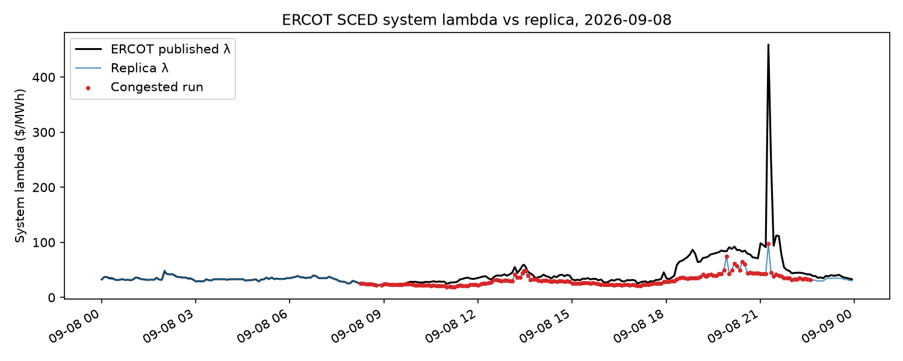

# ercot-sced-replica

Re-clears ERCOT's real-time market from public data. When no transmission constraint binds, the median error against ERCOT's published price is one cent (80% of runs within $0.85).

A replica of ERCOT's real-time market clearing (SCED), being rebuilt from public 60-day disclosure data and validated against published prices.

Status: energy-only clearing of every SCED run in a day from real 60-day data, offer curves solved as a convex QP (HiGHS). A scheduled daily run validates the newest disclosed day; running record in results/daily.csv.

Run the tests: uv sync, then uv run pytest
Run a day: uv run --env-file .env scedrep YYYY-MM-DD (needs ERCOT Public API credentials in .env: ERCOT_API_USERNAME, ERCOT_API_PASSWORD, ERCOT_PUBLIC_API_SUBSCRIPTION_KEY)

Modeling choices:
- Offer curves - SCED2 (mitigated) curves, linear between points, so cost is quadratic and the problem is a convex QP. Checked against ERCOT: hand-interpolating the marginal unit matched published λ to the cent.
- Dispatchable set - online units only (status ON*) with HDL - LDL > 0.1 MW. Offline units (OFF, OUT, EMR) still carry live HDL/LDL in the data; leaving them in cost $13.90 on the first interval.
- Load and fixed injections (fixed gens, ESRs) - taken at SCED base points.
- Validation target - UncappedSystemLambda. Where ERCOT's uncapped value is missing (older days), CappedSystemLambda is used instead; if the live endpoint has no data, the archive's SystemLambda (no capped/uncapped split). The two matched on every 2026-09-08 run.
- Numerical cleaning - segments under 0.1 MW dropped, slopes outside [0.001, 1000] flattened at average price. HiGHS tolerances: primal 1e-4 MW (scale-appropriate for a ~60 GW balance), dual 1e-6 $/MWh. 20 s time limit per SCED run.

Results - error = model λ - ERCOT system lambda. 2026-08-10 to 2026-09-19 (40 days with per-run results, 11,629 SCED runs, 98.4% solved):
- Uncongested runs (3,350) - median error -$0.01/MWh; middle 80% of runs within -$0.83 to +$0.06. The replica reproduces SCED when no transmission constraint binds.
- Congested runs (8,090, 71% of all runs) - median -$4.23; middle 80% within -$32.85 to -$0.06. Copper plate misses congestion; the model runs low.
- Worst uncongested day - 2026-08-27, median -$26.90: a whole-day miss without congestion points at scarcity / AS pricing (next: MCPC axis).
- 2026-09-08 by hour - essentially exact 0:00-8:00; -$6 to -$11 through the solar hours (9-17); -$30 to -$53 at the evening net peak (18-21), with ERCOT at $459 at 21:15.
- Daily summaries in results/daily.csv; per-run detail in results/runs/.

Known gaps:
- Energy only. Post-RTC+B SCED co-optimizes AS; holding SCED's AS awards fixed moved λ by $0.01 on the first interval.
- Copper plate - no transmission constraints.
- No unit commitment - offline and quick-start units are never started.
- Runs that hit the 20 s limit are recorded as failed (ok = False), not solved.
- Daylight-saving: the fall-back repeated hour is matched using ERCOT's RepeatedHourFlag; spring-forward unverified until the daily run reaches mid-March.

## Congestion (in progress)

ERCOT posts shift factors only to the MIS Secure Area, which requires market-participant credentials, so this project doesn't use them. It estimates them from public data instead. In each SCED run, a node's congestion component is LMP − λ = −Σ SF·μ, summed over the binding constraints, so regressing node prices on ERCOT's published shadow prices recovers the shift factors.

Out of sample (test days Sept 15–21, 2026, each trained on the 14 days before it), the median day removes 97% of the squared congestion error compared with predicting no congestion. Five of the seven days are at 96% or better.

Limits that come from not having the real shift factors:
- A constraint that didn't bind in the training window has no estimate. On an average test day, about a quarter of the shadow price falls on such constraints.
- Event days fail. On Sept 16, 2026, 78% of the shadow price was on lines that hadn't bound in the prior two weeks, and the estimate removed only 16% of the error.
- The same line under a different contingency is a separate constraint with its own shift factors, so coverage grows slowly with more history.
- Resources are matched to nodes using ERCOT's latest public mapping file (NP4-160), not the one in force on the day being modeled. 99.9% of resources match.

Notes: Degenerate λ at supply-curve steps - when load lands exactly on a step, any λ between the adjacent offers clears. The original LP returned the upper end (50 of [20, 50]); the segment QP returns the lower (20). Solver/formulation artifact, not a market rule.

Daily run: a scheduled GitHub workflow re-clears the newest disclosed day (about 61 days back) and appends a summary row to results/daily.csv.

Teaching: the repo is also intended as a worked example for teaching optimization and applied ML on real market data. Built so far - LP and QP, from a two-unit toy dispatch with hand-checkable duals, through offer-curve segments as a convex QP, to clearing real ERCOT intervals; the known-answer tests are the worked examples. Planned - supervised learning on the validation results (regressing λ error on congestion, load, renewables and hour, with a date-based train/test split).
